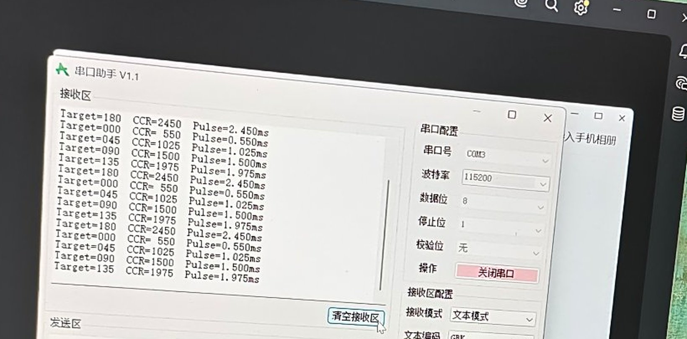

# RM-2027-电控培训-作业-黄予涵

- 姓名：**黄予涵**
- 学号：***20253008098***

用 TIM2_CH1 输出 50Hz PWM 驱动 SG90，按 0° → 45° → 90° → 135° → 180° 依次转动，每点停 1 秒；OLED 显示目标角度、CCR、脉宽三行，串口打印同样的内容。选做部分做了进阶 A：两个按键各 ±15°。

## 一、接线

| 信号 | 接到 | 说明 |
|---|---|---|
| 舵机 橙线（信号） | PA0 | TIM2_CH1，50Hz PWM |
| 舵机 红线（VCC） | 独立 5V 电源（≥1A） | 不从板子 5V 取电 |
| 舵机 棕线（GND） | 独立电源 GND | 同时与板子 GND 相连 |
| OLED SCL / SDA | PB8 / PB9 | 软件 IIC |
| CH340 TX / RX | PA10 / PA9 | 交叉接，共地 |
| 按键 +15° | PA1 接 GND | 内部上拉，按下为低 |
| 按键 −15° | PA2 接 GND | 内部上拉，按下为低 |
| 板载 LED | PC13 | 500ms 翻转一次，看程序有没有在跑 |

SG90 堵转电流接近 700mA，板子的 5V 是从 USB 来的，最多几百毫安，带舵机会掉压甚至复位，所以舵机单独供电，地必须和板子连起来。

## 二、PSC / ARR

TIM2 挂在 APB1 上。APB1 分频是 2，PCLK1 只有 36MHz，但 F1 的定时器在 APB1 分频不为 1 时时钟会自动乘 2，所以 TIM2 的计数时钟是 72MHz。

我把 1 个计数定成 1µs，这样 CCR 的值就等于脉宽的微秒数，后面算角度不用再乘系数。

| 参数 | 取值 | 怎么来的 |
|---|---|---|
| 目标频率 | 50 Hz | 舵机只认这个 |
| 定时器时钟 | 72 MHz | APB1 36MHz × 2 |
| 1 个计数 | 1 µs | 计数频率取 1MHz |
| PSC | 71 | 72MHz ÷ 1MHz − 1 |
| ARR | 19999 | 20ms ÷ 1µs − 1 |

代回去验一遍：

```
f = 72 000 000 ÷ (PSC+1) ÷ (ARR+1)
  = 72 000 000 ÷ 72 ÷ 20 000
  = 50 Hz
```

20ms 周期是 20000 个计数，和 ARR+1 对得上。这里如果按 36MHz 去算，PSC 会填成 35，实际输出 100Hz，舵机不认这个信号，只会一直抖。

## 三、角度换算

名义上 0.5ms 是 0°、2.5ms 是 180°，中位 1.5ms 是 90°。实际 SG90 的行程比标称窄，打满会「咔咔」顶限位、堵转发热，所以两端各收一点，用 550µs ~ 2450µs：

```
CCR = 550 + angle × (2450 − 550) ÷ 180
    = 550 + angle × 10.5556
```

| 角度 | CCR | 脉宽 | 占空比 |
|---|---|---|---|
| 0° | 550 | 0.550 ms | 2.75 % |
| 45° | 1025 | 1.025 ms | 5.12 % |
| 90° | 1500 | 1.500 ms | 7.50 % |
| 135° | 1975 | 1.975 ms | 9.88 % |
| 180° | 2450 | 2.450 ms | 12.25 % |

两端这么取的原因：550 和 2450 都在 500~2500 的合法脉宽内，各留了 50µs 余量，不会顶到机械限位；1900µs 是标称 2000µs 的 95%，折算下来约 171°，和 180° 看不出差别；中点是 1500，90° 还是标准中位，不影响以中位为基准的逻辑。

作业文档 Step 4 的 TODO 1 是把角度夹到 2°~178° 再代入 `500 + angle/180×2000`，两端算出来是 522µs 和 2477µs，离 500/2500 的边界只剩二十几微秒。我改成直接限定脉宽 550~2450，余量更大一些，防顶限位的效果一样。

限幅写在 `Servo_AngleToCCR()` 入口，超过范围的角度先夹到 0~180 再换算，上层传什么值都不会打满：

```c
if (angle < 0.0f)     angle = 0.0f;
if (angle > 180.0f)   angle = 180.0f;
```

## 四、显示和串口

OLED 三行格式固定，验收时好核对：

```
Target:090deg
CCR   :1500
Pulse :1.500ms
```

角度一变化就整屏刷一次，平时每 250ms 兜底刷一次。软件 IIC 一屏 1KB，降速到 150kHz 左右之后刷一次要 60ms，所以不能逐帧刷；兜底那次是为了万一某次被舵机的电源噪声干扰花了屏，最多 250ms 就被正确数据盖回来。

串口是 USART1，115200 8N1，上电先发一行横幅，之后角度变一次打一行：

```
[BOOT] RM-2027 Servo, USART1 115200 8N1
Target=090  CCR=1500  Pulse=1.500ms
```

串口助手里用文本模式看，选 HEX 模式会显示成 `54 61 72 67 65 74 ...` 这种十六进制，看着像乱码。上电头几个字节偶尔是 `FF` 或 `41`，是 PA9 从浮空切到复用时的毛刺，按一下复位就干净了。

`printf` 的重定向用 GCC 的 `_write`，不是 Keil 的 `__io_putchar`，里面调 `HAL_UART_Transmit` 阻塞发送。一次几十个字节，阻塞不到 4ms，够用。

串口实拍（COM3，115200，文本模式）：



五个角度按 1 秒间隔循环输出，每行三组数和 OLED 那三行是同一个来源：CCR 就是比较寄存器的值（1 个计数 1µs），Pulse 是这个值换成毫秒。

## 五、进阶 A：按键调角

PA1 每次加 15°，PA2 每次减 15°，范围夹在 0~180°。两个按键都配成内部上拉，按下是低电平，所以接线就是引脚、按键、GND 三样，不用外接电阻。

消抖没有用 `HAL_Delay(20)`，那样会把主循环卡住 20ms。做法是每 5ms 读一次电平，发现变化先把新电平和时刻记成候选，等它保持 20ms 没再变，才认为真的按下了：

```c
if (raw[i] != s_keyCandidate[i])                     /* 电平变了，先记候选 */
{
  s_keyCandidate[i] = raw[i];
  s_keyCandTick[i]  = now;
}
else if ((s_keyCandidate[i] != s_keyStable[i]) &&
         ((now - s_keyCandTick[i]) >= KEY_DEBOUNCE_MS))   /* 保持 20ms 没变，确认 */
{
  s_keyStable[i] = s_keyCandidate[i];
  if (s_keyStable[i] == 0U)                          /* 只认按下这一个边沿 */
  {
    *delta += (i == 0U) ? KEY_STEP_DEG : -KEY_STEP_DEG;
    pressed = 1U;
  }
}
```

按下就加，不等松开，长按也只加一次；20ms 以内的抖动会被丢掉；角度在驱动里限幅，0° 再减、180° 再加都不会动；按键后把 `s_displayDirty` 置位，OLED 马上刷。

按键按下的时候自动序列会暂停，免得刚调好就被序列跳走，停手 5 秒后从当前点继续往下走，演示时不用按复位。

## 六、序列为什么不用 HAL_Delay

文档 Step 8 用 `HAL_Delay(1000)` 推序列，那样一秒钟里按键完全没反应，进阶 A 就做不了。这里改成用 `HAL_GetTick()` 比时间戳：

```c
if ((now - s_seqTick) >= SEQ_HOLD_MS)   /* 到点才推进，没到就直接返回 */
{
  s_seqTick  = now;
  s_seqIndex = (uint8_t)((s_seqIndex + 1U) % SEQ_POINT_NUM);
  Servo_SetAngle(s_seq[s_seqIndex]);
}
```

`now - s_seqTick` 是无符号减法，计数器回绕也不会算错。

## 七、工程结构

```
RM2027_Servo/
├── RM2027_Servo.ioc          CubeMX 配置（TIM2 PWM / USART1 / GPIO）
├── CMakeLists.txt
├── cmake/
│   └── gcc-arm-none-eabi.cmake   交叉工具链，CMakeLists 里用 CMAKE_TOOLCHAIN_FILE 引
├── Core/
│   ├── Inc/  main.h  gpio.h  tim.h  usart.h  Servo.h  OLED.h  OLED_Font.h
│   ├── Src/  main.c  gpio.c  tim.c  usart.c  Servo.c  OLED.c
│   └── Startup/startup_stm32f103c8tx.s
├── Drivers/                  HAL + CMSIS（含 TIM 模块）
└── docs/                     串口截图、全册知识点笔记
```

## 八、编译和烧录

1. CLion 打开工程根目录，也就是有 `CMakeLists.txt` 和 `.ioc` 的那一层，等 CMake 加载完；
2. `Ctrl+F9` 编译；
3. ST-Link 接 SWD 四根线（3V3、GND、SWDIO、SWCLK），下载运行；
4. 上电后舵机依次转五个角度，OLED 和串口同步刷新。

以后要回 CubeMX 改配置，重新生成时保留 `USER CODE` 段，自己写的代码就不会被冲掉。
